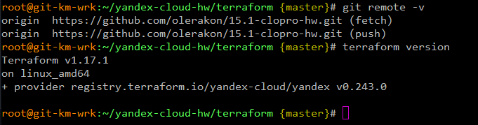
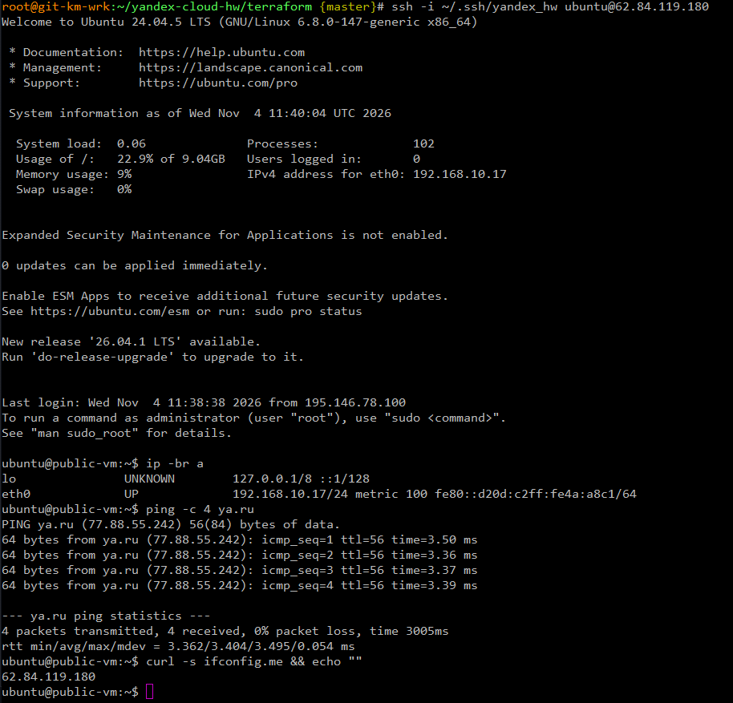
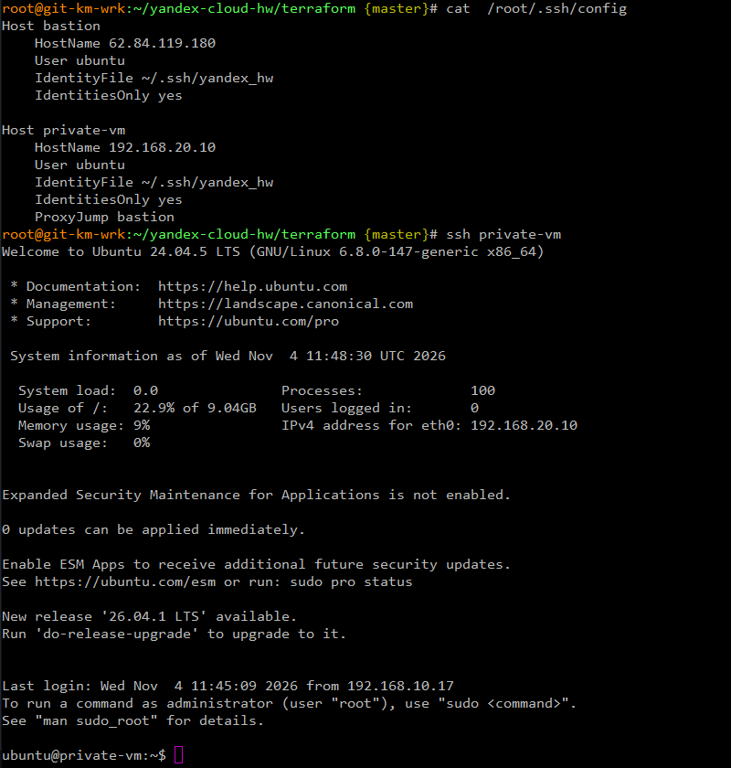
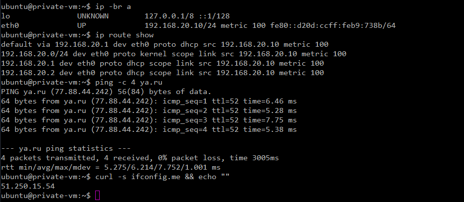
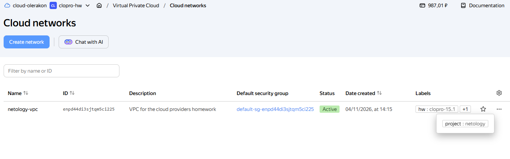
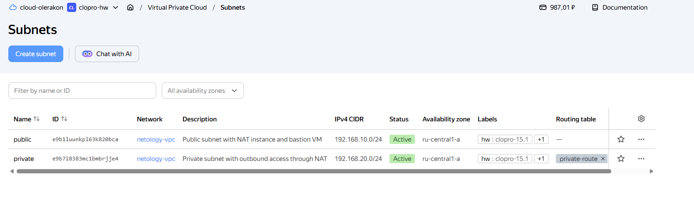
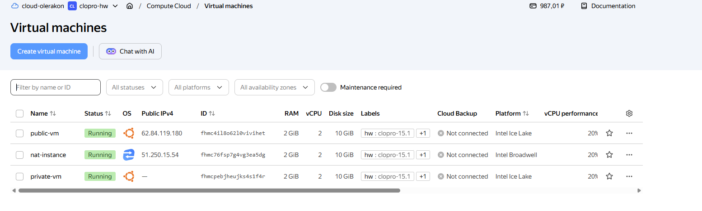
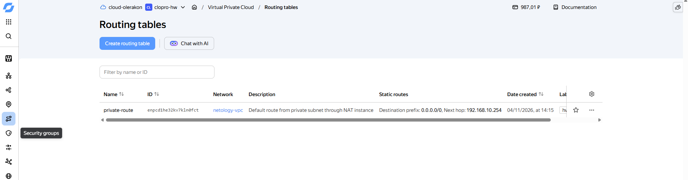

# Домашнее задание к занятию «Организация сети» - `Гилельс Кирилл`

## Предварительная информация

На VM Ubuntu 24.04 LTS был установлен актуальный Terraform v1.17.1

Яндекс клауд провайдер версии v0.243.0

IP адресс машины 192.168.140.145

Так же был инициализирован гит [репозиторий](https://github.com/olerakon/15.1-clopro-hw) проекта 

Для домашнего задания был создан отдельный каталог: `yandex-cloud-hw` 

В облаке был создан каталог `clopro-hw`, создан сервисный аккаунт `terraform` с правами `editor`. Сгенерирован json ключ и ssh ключ под пользователя для VM. 

Сводная информация представлена на скриншоте:



------

### Задание 1. Yandex Cloud 

**Что нужно сделать**

1. Создать пустую VPC. Выбрать зону.
2. Публичная подсеть.

 - Создать в VPC subnet с названием public, сетью 192.168.10.0/24.
 - Создать в этой подсети NAT-инстанс, присвоив ему адрес 192.168.10.254. В качестве image_id использовать fd80mrhj8fl2oe87o4e1.
 - Создать в этой публичной подсети виртуалку с публичным IP, подключиться к ней и убедиться, что есть доступ к интернету.
3. Приватная подсеть.
 - Создать в VPC subnet с названием private, сетью 192.168.20.0/24.
 - Создать route table. Добавить статический маршрут, направляющий весь исходящий трафик private сети в NAT-инстанс.
 - Создать в этой приватной подсети виртуалку с внутренним IP, подключиться к ней через виртуалку, созданную ранее, и убедиться, что есть доступ к интернету.

Resource Terraform для Yandex Cloud:

- [VPC subnet](https://registry.terraform.io/providers/yandex-cloud/yandex/latest/docs/resources/vpc_subnet).
- [Route table](https://registry.terraform.io/providers/yandex-cloud/yandex/latest/docs/resources/vpc_route_table).
- [Compute Instance](https://registry.terraform.io/providers/yandex-cloud/yandex/latest/docs/resources/compute_instance).

------

### Решение 

Структура репозитория 

```bash
.
├── img                                      # скриншоты
│   ├── 0.png
│   ├── 1.1.png
│   ├── 1.png
│   ├── 2.png
│   ├── 3.png
│   ├── 4.png
│   ├── 5.png
│   └── 6.png
├── REDAME.md
└── terraform
    ├── cloud-init.yml                      # создание пользователя и загрузка SSH-ключа
    ├── nat.tf                              # NAT-инстанс 
    ├── network.tf                          # VPC, подсети public/private, route table
    ├── providers.tf                        # провайдер yandex-cloud/yandex
    ├── terraform.tfstate                   
    ├── terraform.tfstate.backup
    ├── terraform.tfvars
    ├── variables.tf                        # входные переменные
    └── vms.tf                              # публичная (bastion) и приватная ВМ
```

## 1. Пустая VPC

Создана сеть `netology-vpc` (`terraform/network.tf`), зона `ru-central1-a`.

## 2. Публичная подсеть

* Подсеть `public`, CIDR `192.168.10.0/24`.
* NAT-инстанс с фиксированным внутренним адресом `192.168.10.254`,
  образ `fd80mrhj8fl2oe87o4e1`, выдан публичный IP.
* ВМ `public-vm` с публичным IP.

## 3. Приватная подсеть

* Подсеть `private`, CIDR `192.168.20.0/24`.
* Таблица маршрутизации `private-nat-route-table` со статическим маршрутом
  `0.0.0.0/0 -> 192.168.10.254`, привязана к подсети `private`.
* ВМ `private-vm` (`192.168.20.10`) только с внутренним IP.

После подготовки манифестов:
```bash
terraform init
terraform validate
terraform plan
terraform apply -y


Apply complete! Resources: 7 added, 0 changed, 0 destroyed.
```

На выходе получили:
```bash
nat_instance_private_ip = "192.168.10.254"
nat_instance_public_ip  = "51.250.15.54"
private_vm_ip           = "192.168.20.10"
public_vm_private_ip    = "192.168.10.17"
public_vm_public_ip     = "62.84.119.180"
```

Проверка подключения и доступа в сеть у public-vm.



Публичная ВМ выходит в интернет напрямую — внешний адрес совпадает с её собственным публичным IP.

Проверка подключения и доступа в сеть у private-vm.

Для удобства подключения был создан ssh config





Подтверждение работы NAT: на приватной ВМ нет публичного адреса на интерфейсе, а curl ifconfig.me возвращает 51.250.15.54 — публичный IP NAT-инстанса. Значит, исходящий трафик приватной подсети действительно проходит через NAT-инстанс по статическому маршруту 0.0.0.0/0

Подсети VPC



Подсети



Список виртуальных машин



NAT-инстанс



------

### Задание 2. AWS* (задание со звёздочкой) - работа выполнялась в корпоративной среде, задание не выполнялось.

Это необязательное задание. Его выполнение не влияет на получение зачёта по домашней работе.

**Что нужно сделать**

1. Создать пустую VPC с подсетью 10.10.0.0/16.
2. Публичная подсеть.

 - Создать в VPC subnet с названием public, сетью 10.10.1.0/24.
 - Разрешить в этой subnet присвоение public IP по-умолчанию.
 - Создать Internet gateway.
 - Добавить в таблицу маршрутизации маршрут, направляющий весь исходящий трафик в Internet gateway.
 - Создать security group с разрешающими правилами на SSH и ICMP. Привязать эту security group на все, создаваемые в этом ДЗ, виртуалки.
 - Создать в этой подсети виртуалку и убедиться, что инстанс имеет публичный IP. Подключиться к ней, убедиться, что есть доступ к интернету.
 - Добавить NAT gateway в public subnet.
3. Приватная подсеть.
 - Создать в VPC subnet с названием private, сетью 10.10.2.0/24.
 - Создать отдельную таблицу маршрутизации и привязать её к private подсети.
 - Добавить Route, направляющий весь исходящий трафик private сети в NAT.
 - Создать виртуалку в приватной сети.
 - Подключиться к ней по SSH по приватному IP через виртуалку, созданную ранее в публичной подсети, и убедиться, что с виртуалки есть выход в интернет.

Resource Terraform:

1. [VPC](https://registry.terraform.io/providers/hashicorp/aws/latest/docs/resources/vpc).
1. [Subnet](https://registry.terraform.io/providers/hashicorp/aws/latest/docs/resources/subnet).
1. [Internet Gateway](https://registry.terraform.io/providers/hashicorp/aws/latest/docs/resources/internet_gateway).

### Правила приёма работы

Домашняя работа оформляется в своём Git репозитории в файле README.md. Выполненное домашнее задание пришлите ссылкой на .md-файл в вашем репозитории.
Файл README.md должен содержать скриншоты вывода необходимых команд, а также скриншоты результатов.
Репозиторий должен содержать тексты манифестов или ссылки на них в файле README.md.